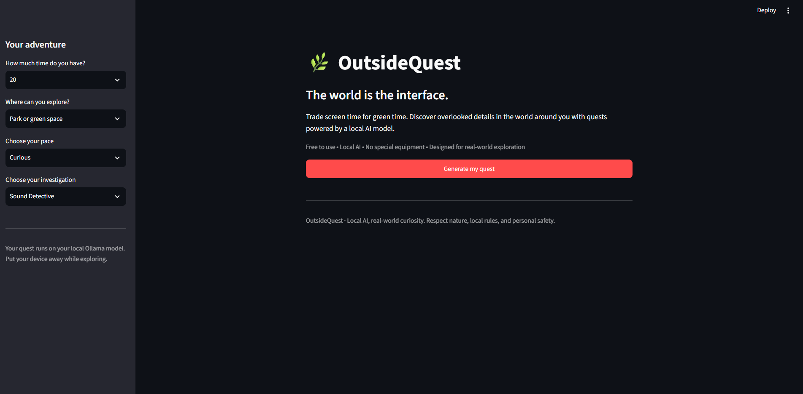
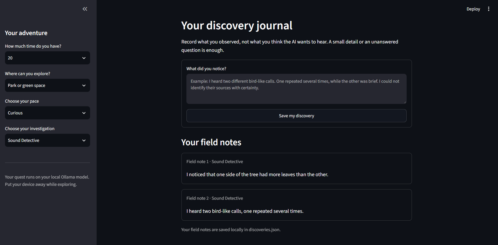

# 🌿 OutsideQuest

### The world is the interface.

**OutsideQuest** is a local-AI-powered outdoor discovery application designed to encourage people to step away from their screens and explore the world through guided observation missions.

From unusual sound patterns to light, shadows, and overlooked details in nature, OutsideQuest turns everyday surroundings into opportunities for curiosity and investigation.

> 🌱 Built for the **DEV Community Hacktoberfest Week 1 Challenge — “Touch Grass.”**

## 🖥️ OutsideQuest in Action

Explore the interface of OutsideQuest, where local AI turns everyday surroundings into opportunities for discovery.



## ✨ Features

- **AI-generated missions:** Generate outdoor investigations based on the selected mission type, environment, and available time.
- **Local AI inference:** Use Ollama with the Qwen 3.5 4B model to generate missions locally.
- **Discovery journal:** Record observations and preserve field notes locally in `discoveries.json`.
- **Follow-up investigations:** Turn an observation into possible explanations, new questions, and a follow-up experiment.
- **Safety-conscious exploration:** Encourage direct observation without requiring photography, special equipment, or interaction with wildlife.

### 📝 Discovery Journal

Field notes are saved locally on the computer running OutsideQuest. Users can revisit their observations and use them as starting points for further investigations.



## 🛠️ Tech Stack

| Technology | Purpose |
|---|---|
| Python | Application logic |
| Streamlit | Interactive web interface |
| Ollama | Local model inference |
| Qwen 3.5 4B | Mission generation and follow-up investigations |
| Requests | Communication with the Ollama API |
| JSON | Local field-note persistence |

## ⚙️ Prerequisites

Before running OutsideQuest, install:

- Python
- [Ollama](https://ollama.com/)
- The `qwen3.5:4b` model

## 🚀 Run Locally

### 1. Clone the repository

```bash
git clone https://github.com/pratyushmishra9920-ship-it/outsidequest-ai.git
cd outsidequest-ai
```

### 2. Create and activate a virtual environment

For Windows PowerShell:

```powershell
python -m venv .venv
.\.venv\Scripts\Activate.ps1
```

### 3. Install dependencies

```powershell
python -m pip install streamlit requests
```

### 4. Download the AI model

```powershell
ollama pull qwen3.5:4b
```

Ensure Ollama is installed and running before starting the application.

### 5. Launch OutsideQuest

```powershell
python -m streamlit run app.py
```

Open the local URL displayed in the terminal, usually `http://localhost:8501`.

## 💾 Local Data and Privacy

OutsideQuest stores field notes in `discoveries.json` on the computer running the application. The journal does not require a cloud database.

AI generation uses the local Ollama service configured by the application.

## 🌱 Vision

OutsideQuest explores a simple idea: the world around us can be more interesting when we slow down and pay attention.

By combining local AI with real-world observation, the project aims to make everyday exploration more curious, interactive, and evidence-driven.

---

*OutsideQuest — Local AI, real-world curiosity.*
